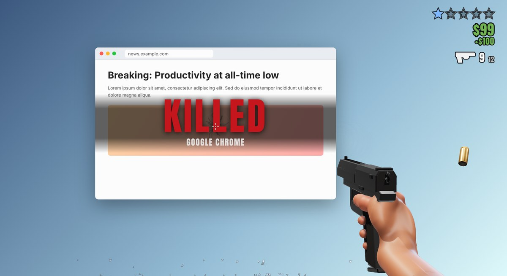

```
  ╭─┼─╮  █   █ ▀█▀ █▄  █ █▀▀▀▄ ▄▀▀▀▄ █   █   ▄▀▀▀▀ █▄  █ ▀█▀ █▀▀▀▄ █▀▀▀▀ █▀▀▀▄
  ┼ ● ┼  █▄▀▄█  █  █ ▀▄█ █   █ █   █ █▄▀▄█    ▀▀▀▄ █ ▀▄█  █  █▀▀▀  █▀▀▀  █▀▀█
  ╰─┼─╯  ▀   ▀ ▀▀▀ ▀   ▀ ▀▀▀▀   ▀▀▀  ▀   ▀   ▀▀▀▀  ▀   ▀ ▀▀▀ ▀     ▀▀▀▀▀ ▀   ▀

         Shoot a window. It closes.
```

<p align="center">
  
</p>

<p align="center"><b>A GTA-style pistol for your desktop.</b> Mac, Windows, Linux. Free.</p>

## Install

**Mac / Linux** (Terminal)
```bash
curl -fsSL https://raw.githubusercontent.com/zaenae/WindowSniper/main/install.sh | bash
```

**Windows** (PowerShell)
```powershell
irm https://raw.githubusercontent.com/zaenae/WindowSniper/main/install.ps1 | iex
```

One line, nothing else needed.

<p align="center">
  
</p>

## Play

| | |
|---|---|
| **Ctrl+Alt+G** (Mac: **⌘⌥G**) | Pull out the gun |
| **Click** | Shoot |
| **Esc** | Put it away |

3 shots kill a window. Shoot the title bar for a headshot.

<details>
<summary><b>Shots don't close anything?</b></summary>

- **Mac:** allow it in System Settings → Privacy & Security → Accessibility.
- **Linux:** needs X11 and `sudo apt install x11-utils wmctrl xdotool`.
</details>

<details>
<summary><b>More</b></summary>

- **Start at login / Quit:** right-click the crosshair in your menu bar or tray.
- **Uninstall:** delete `~/WindowSniper` (Mac/Linux) or `%LOCALAPPDATA%\WindowSniper` (Windows).
- **Tweak it:** gun feel at the top of `gun.html`, health and hotkey at the top of `main.js`.
</details>

---

<sub>Fan-made joke inspired by GTA. Not affiliated with Rockstar Games or Take-Two. MIT license.</sub>
